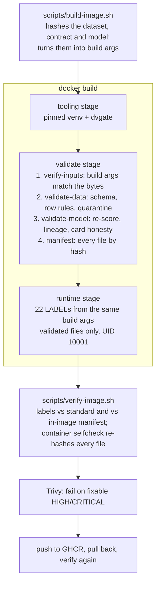

# Dockerfile Data Validation

[](https://github.com/gbadedata/dockerfile-data-validation/actions/workflows/ci.yml)


**A Docker build that will not produce an image unless the dataset, its schema and the model artefact pass validation, and that labels every image with what it contains, by hash.**

Built with Python, Bash, Docker (multi-stage, BuildKit), GitHub Actions, Trivy and GHCR.

## The short version

| | |
|---|---|
| **Dataset** | [Palmer Penguins](https://github.com/allisonhorst/palmerpenguins), 344 rows, CC0. 2 rows quarantined (all four measurements missing); 11 kept with a warning (sex not recorded). |
| **Model** | Logistic regression stored as plain JSON (no pickle). 98.6% accuracy and 0.982 macro-F1 on a 69-row stratified holdout, re-scored inside the build rather than read from the model card. |
| **Labels** | 22 required labels: 7 OCI keys and 15 in the `io.gbadedata` namespace. Each is checked for format, and the identity labels are checked against a manifest written inside the image. |
| **Negative tests** | 7 deliberately broken inputs. CI must reject each one, and for the expected reason. |
| **Unit tests** | 53 |

## What a build does



Any failing gate stops `docker build`. There is no image to push.

The runtime stage copies its reports from the validate stage. That dependency
matters: BuildKit skips stages the target does not need, so without it a build
of the final stage could skip every gate.

## Labels

Every value is computed, never typed: from the files (`dvgate build-args`), from
git, or from the clock. The full table, with formats and sources, is in
[docs/label-standard.md](docs/label-standard.md).

```console
$ docker image inspect dockerfile-data-validation:local --format '{{json .Config.Labels}}'
{
  "io.gbadedata.dataset.name": "palmer-penguins",
  "io.gbadedata.dataset.revision": "8957207b78d6ccd1b4654a9dd9c9041b657478ab",
  "io.gbadedata.dataset.sha256": "f204db2c753b0937caac3cb35258562c14f073e4bbc76be24b4c51ce22767a93",
  "io.gbadedata.dataset.version": "2024.09.19",
  "io.gbadedata.label-standard.version": "1.0.0",
  "io.gbadedata.model.name": "penguin-species-classifier",
  "io.gbadedata.schema.version": "1.0.0",
  "io.gbadedata.validation.policy": "fail-closed",
  "org.opencontainers.image.licenses": "MIT AND CC0-1.0",
  ...
}
```

Labels are checked at three points:

1. **Before the build**, `dvgate lint-dockerfile` fails if the final stage does not
   declare a required label, or declares one from a build arg it never defines.
2. **During the build**, `dvgate verify-inputs` fails if a build arg is empty or does
   not describe the bytes in the build context.
3. **After the build**, `dvgate check-labels` compares the labels with the manifest
   inside the image. That catches a label changed with `docker build --label` after
   the gates ran.

## What CI proves

The `image` job builds the real image, verifies it, then builds each broken
input and asserts it fails. [`scripts/expect-failure.sh`](scripts/expect-failure.sh)
requires both a non-zero exit **and** the expected message, so a negative test
cannot pass because something unrelated broke.

| Broken input | Caught by | Expected failure |
|---|---|---|
| 8 invalid values and 2 duplicate rows ([fixture](fixtures/bad-values)) | data gate | `dataset.duplicate_rows`, `dataset.quarantine_fraction` (2.89% against a 2% limit) |
| `island` column removed ([fixture](fixtures/missing-column)) | data gate | `schema.required_columns: missing: ['island']` |
| Model card claims 0.999 accuracy ([fixture](fixtures/model-inflated-card)) | model gate | `card.accuracy: card says 0.999, re-scored 0.98550725` |
| `DATASET_SHA256` build arg set to zeros | input gate | `build_arg.dataset.sha256: build arg says '000…', file is 'f204…'` |
| Label overridden with `docker build --label` | post-build check | `label … but the image contains 'f204…'` |
| A row appended to the shipped CSV after the build ([fixture](fixtures/Dockerfile.tampered)) | container selfcheck | `file.data/dataset.csv: CHANGED` |
| `dataset.sha256` label deleted from the Dockerfile | static lint | `declared.io.gbadedata.dataset.sha256: not declared in the final stage` |

The `checks` job also retrains the model and fails unless the result is
byte-identical to the committed artefact, and regenerates the fixtures and fails
if they drift.

## Validation rules

Three gates run inside the build. Bad rows are quarantined with reason codes
(`body_mass_g:out_of_range`, `species:not_allowed`, …) and shipped in
`/app/reports/quarantine.csv`, never dropped silently. Dataset-level rules
(schema, duplicates, quarantine share, class coverage) fail the build. The model
is re-scored on the validated data, and its lineage is checked: it must have been
trained on this exact dataset file under this contract version. Details are in
[docs/validation-logic.md](docs/validation-logic.md); ownership and change control
are in [docs/data-governance.md](docs/data-governance.md).

Exit codes: `0` passed, `2` a gate failed, `1` configuration error. A typo in a
contract is never reported as bad data.

## Mistakes this is built to avoid

| Mistake | What happens here instead |
|---|---|
| Labels typed by hand drift away from the content | Computed from the files, checked during and after the build |
| A build of the final stage silently skips the validation stage | The runtime stage copies reports from `validate`, so BuildKit must run it |
| An empty build arg produces an empty label and a green build | Empty values fail `verify-inputs` |
| A typo such as `dataset.sha265` passes unnoticed | Unknown keys in the namespace fail the standard |
| A secret ends up in a label, which is public metadata | Credential-like keys and values fail the standard |
| Bad rows are dropped silently | Quarantined with reasons and shipped inside the image |
| The model card overstates the model | The model is re-scored; the card must match to 1e-6 |
| A model trained on other data is shipped with this data | Lineage check on the training dataset's hash and contract version |
| Pickled model files run code when loaded | Parameters stored as JSON; prediction needs only NumPy |
| Unpinned dependencies change between builds | `requirements.lock`, installed into a venv in the tooling stage |
| The container runs as root | UID 10001, checked by `verify-image.sh` |
| The base image ships with vulnerabilities that already have a fix | The runtime stage applies Debian security updates; Trivy fails CI on any fixable HIGH or CRITICAL finding |

## Run it

```bash
python -m pip install -r requirements.lock -r requirements-train.lock
python -m pip install -e ".[dev]"
pytest                                      # 53 unit tests
dvgate lint-dockerfile                      # static label check

scripts/build-image.sh dockerfile-data-validation:local
scripts/verify-image.sh dockerfile-data-validation:local reports/local
docker run --rm dockerfile-data-validation:local    # selfcheck

# Watch a gate reject bad data:
DATASET_RECORD=fixtures/bad-values/dataset.yaml scripts/build-image.sh rejected:local
```

Published images (from `main`):

```bash
docker pull ghcr.io/gbadedata/dockerfile-data-validation:latest
```

## Repository layout

```text
Dockerfile                 three stages: tooling, validate, runtime
standards/labels.v1.yaml   the label standard (machine-readable)
contracts/                 data contract and model contract
data/dataset.yaml          provenance record: upstream repo, commit, hash, licence
data/raw/penguins.csv      the dataset, pinned to upstream commit 8957207
model/                     model.json (parameters) and model_card.json
src/dvgate/                validators: data.py, model.py, labels.py, manifest.py, cli.py
scripts/                   build-image.sh, verify-image.sh, expect-failure.sh
fixtures/                  deliberately broken inputs, and the script that makes them
docs/                      label standard, validation logic, data governance
tests/                     53 unit tests
```

## Limits

- The labels and manifest prove an image is consistent with itself, not who built
  it. Image signing and build provenance attestations are the next step.
- The model is a small teaching example. The point is the gates around it, not
  the classifier.
- Trivy reports known vulnerabilities that have a fix available; it is not a full
  security review.

## Data and licences

Code is MIT-licensed. The dataset is Palmer Penguins (Gorman, Williams and
Fraser, 2014), packaged by Horst, Hill and Gorman (2020) and released under
CC0 1.0. The image's licence label is therefore `MIT AND CC0-1.0`.
